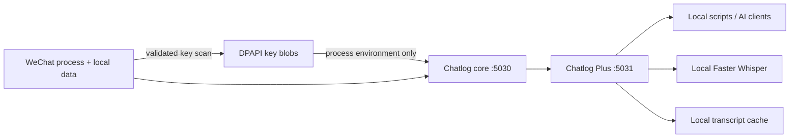

# WeChat Chatlog Plus

**首个面向 Windows 微信 4.x、支持新版掩码数据密钥提取，并提供可复现构建、
DPAPI 本地密钥保存、媒体解析和语音转写的一体化 Chatlog 方案。**

A reproducible, local-only Windows stack for querying WeChat chat history and resolving or
transcribing local media. It includes:

- a pinned, source-reproducible Chatlog core on `127.0.0.1:5030`;
- automatic WeChat 3.x/4.x key discovery and validation;
- Windows DPAPI storage for keys (current Windows user only);
- the Chatlog Plus media and voice companion on `127.0.0.1:5031`;
- one-command start, diagnostics, startup registration, and uninstall scripts.


> Fork note: based on [Sherlock488/wechat-chatlog-plus](https://github.com/Sherlock488/wechat-chatlog-plus); this fork adds on-demand Moments (朋友圈) lookup and export.

No WeChat database, key, media file, transcript, account detail, or model is committed to
this repository or uploaded by the stack.

## Architecture



The key extractor is built from Chatlog commit
[`eb9572e`](https://github.com/imldy/chatlog/commit/eb9572ee028cbaa72a50749b9dfe6630b317228f).
The small patch in [`patches/chatlog-safe-local.patch`](patches/chatlog-safe-local.patch)
redacts keys from logs, prevents the key command from persisting plaintext keys, and emits
the non-secret metadata needed by the DPAPI wrapper. See
[`docs/KEY_EXTRACTION.md`](docs/KEY_EXTRACTION.md) for the exact scan and validation flow.

## Requirements

- Windows 10 or 11 (64-bit)
- Python 3.10 or newer
- Git
- WeChat desktop, logged in and open while keys are saved the first time

Go and GCC are needed only when using `-BuildCoreFromSource`. Normal setup downloads the
pinned release binary and verifies its SHA-256 digest before installing it.

## Quick start

Open PowerShell in the cloned repository:

```powershell
Set-ExecutionPolicy -Scope Process Bypass
.\scripts\setup.ps1
.\scripts\save-wechat-keys.ps1
.\scripts\start-stack.ps1
```

Keep WeChat open on its main window during `save-wechat-keys.ps1`. When several WeChat
processes exist, the wrapper tries their PIDs in turn and saves only a key that validates
against the corresponding local database. Successful extraction prints the data key and, when
available, the image key in the user's current PowerShell window. Weixin 4.x does not always
keep an image key in readable process memory; text chat still works, and an already saved image
key is retained. Use `-Quiet` when terminal display is unwanted.

Check the installation:

```powershell
.\scripts\doctor.ps1
Invoke-RestMethod http://127.0.0.1:5031/health
```

The stack is stored under `%LOCALAPPDATA%\WeChatChatlogStack` by default. To put large
models, decrypted working data, and caches on another drive, set the location before setup:

```powershell
$env:WECHAT_CHATLOG_HOME = 'D:\WeChatChatlogStack'
.\scripts\setup.ps1
```

Use the same environment variable in future PowerShell sessions. Startup registration captures
both the repository script path and the resolved stack home used when it is registered.

## Lifecycle

```powershell
# Start or stop both layers
.\scripts\start-stack.ps1
.\scripts\stop-stack.ps1

# Refresh keys after a WeChat update or account change
.\scripts\save-wechat-keys.ps1 -Force

# Save without displaying the keys
.\scripts\save-wechat-keys.ps1 -Force -Quiet

# Start automatically after Windows sign-in
.\scripts\register-startup.ps1

# Remove startup registration
.\scripts\unregister-startup.ps1

# Preview, then uninstall the managed local state
.\scripts\uninstall.ps1 -WhatIf
.\scripts\uninstall.ps1
```

To rebuild the core from the exact source instead of downloading the verified release:

```powershell
.\scripts\setup.ps1 -BuildCoreFromSource
```

The build script uses an isolated, commit-named checkout, refuses to overwrite dirty source,
applies the checked-in patch, and builds with `CGO_ENABLED=1`.

## Usage

Query messages and attach media status:

```powershell
.\.venv\Scripts\python.exe .\chatlog_plus.py chatlog `
  --time 2026-08-26 `
  --talker CONTACT_OR_GROUP `
  --resolve-media
```

Query and locally transcribe up to 20 voice messages:

```powershell
.\.venv\Scripts\python.exe .\chatlog_plus.py chatlog `
  --time 2026-08-26 `
  --talker CONTACT_OR_GROUP `
  --resolve-media `
  --transcribe-voice
```

HTTP equivalent:

```text
http://127.0.0.1:5031/api/v1/chatlog?time=2026-08-26&talker=CONTACT_OR_GROUP&format=json&resolve_media=1&transcribe_voice=1
```

### Moments lookup (朋友圈)

`moments` decrypts a private copy of `db_storage/sns/sns.db` with the same DPAPI key,
reads it, and deletes the plaintext copy. It never modifies the source database.

**On-demand (default): one person, no files written.**

```powershell
# Resolve a remark/nickname via contact.db, print that person's Moments as JSON
.\.venv\Scripts\python.exe .\chatlog_plus.py moments person --name "刘立群" --limit 20

# Or skip name resolution
.\.venv\Scripts\python.exe .\chatlog_plus.py moments person --wxid wxid_xxx --since 2026-01-01
```

Use this together with `chatlog` when analysing a contact: chat history plus that person's
own Moments. Output goes to stdout; nothing is written to disk unless `--out` is given.

**Bulk export: only when an archive is actually needed.**

```powershell
.\.venv\Scripts\python.exe .\chatlog_plus.py moments export --out D:\private\moments --self-only --format both
```

Limits:

- Only data already synced to this PC; phone-only history is not included.
- Images and videos are exported as reference URLs, not files.
- If `sns.db-wal` is non-empty, the newest few entries may be missing; a warning is printed.
- Exports contain private text. Prefer `moments person` (stdout, no file) and write only
  derived conclusions into the customer archive.

## Configuration

| Variable | Default | Purpose |
| --- | --- | --- |
| `WECHAT_CHATLOG_HOME` | `%LOCALAPPDATA%\WeChatChatlogStack` | Core, model, cache, log, and DPAPI state root |
| `CHATLOG_CORE_URL` | `http://127.0.0.1:5030` | Chatlog core URL used by Plus |
| `CHATLOG_PLUS_HOST` | `127.0.0.1` | Enhanced API bind address |
| `CHATLOG_PLUS_PORT` | `5031` | Enhanced API port |
| `CHATLOG_PLUS_MODEL` | `turbo` | Faster Whisper model |
| `CHATLOG_PLUS_LANGUAGE` | `zh` | Language, or `auto` for detection |
| `CHATLOG_PLUS_DEVICE` | `auto` | `auto`, `cpu`, or `cuda` |
| `CHATLOG_PLUS_COMPUTE_TYPE` | automatic | `int8` on CPU or `float16` on CUDA |

Do not bind either service to `0.0.0.0` without adding authentication and a trusted network
boundary.

## API

- `GET /health`
- `GET /api/v1/chatlog` — Chatlog query plus optional enrichment
- `GET /api/v1/transcript/<voice_id>` — transcribe one voice message
- `GET /api/v1/media/status?type=<type>&key=<key>` — probe one media item
- `GET /api/v1/session`, `/api/v1/contact`, `/api/v1/chatroom` — proxy core endpoints

Extra `/api/v1/chatlog` parameters are `resolve_media=1`, `transcribe_voice=1`,
`transcript_limit`, `transcript_model`, and `transcript_language`.

## Privacy and licensing

The transcript cache contains private message text. DPAPI protects the saved keys from other
Windows users but does not protect data after the signed-in user launches the processes. Read
[`SECURITY.md`](SECURITY.md) before exposing or sharing any state directory.

Chatlog Plus is MIT-licensed. The pinned Chatlog core source and resulting binary remain under
Apache-2.0; modifications are documented in the checked-in patch and
[`THIRD_PARTY_NOTICES.md`](THIRD_PARTY_NOTICES.md).
