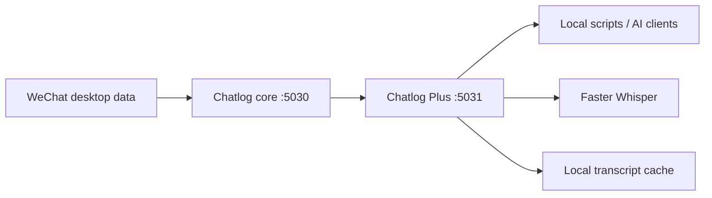

# WeChat Chatlog Plus

A local companion service for [Chatlog](https://github.com/majin72/chatlog). It enriches
Chatlog's JSON responses with usable media URLs, media availability checks, and local
voice transcription powered by Faster Whisper.

Chatlog Plus does **not** contain or upload WeChat databases, keys, media, transcripts,
or account information. Both services listen on loopback by default.

## Architecture



- **Chatlog core (`127.0.0.1:5030`)** decrypts and queries the user's local WeChat data.
- **Chatlog Plus (`127.0.0.1:5031`)** proxies supported queries, resolves media, and
  transcribes voice messages locally.
- The two layers remain separate so this repository never redistributes a modified Chatlog
  binary or private data.

## Features

- Adds direct URLs for image, video, voice, and file messages.
- Checks whether referenced media is actually present locally.
- Marks videos for which only a thumbnail is available.
- Transcribes voice messages with a local Faster Whisper model.
- Caches transcripts in SQLite so the same voice message is not processed twice.
- Supports HTTP and command-line use.

## Requirements

- Windows 10/11
- Python 3.10 or newer
- A working local [Chatlog](https://github.com/majin72/chatlog) server on port 5030
- Enough disk space for the selected Faster Whisper model

## Quick start

1. Install and configure Chatlog from its upstream documentation, then start its local HTTP
   server at `http://127.0.0.1:5030`.
2. Clone this repository and open PowerShell in the repository directory.
3. Install the Python environment:

   ```powershell
   Set-ExecutionPolicy -Scope Process Bypass
   .\scripts\setup.ps1
   ```

4. Start the enhanced service:

   ```powershell
   .\scripts\start-chatlog-plus.ps1
   ```

5. Check both layers:

   ```powershell
   .\.venv\Scripts\python.exe .\chatlog_plus.py doctor
   Invoke-RestMethod http://127.0.0.1:5031/health
   ```

By default, models, logs, and the transcript cache are stored under
`%LOCALAPPDATA%\ChatlogPlus`, outside the Git repository.

## Usage

Query messages and attach media status:

```powershell
.\.venv\Scripts\python.exe .\chatlog_plus.py chatlog `
  --time 2026-08-26 `
  --talker CONTACT_OR_GROUP `
  --resolve-media
```

Query and locally transcribe up to 20 voice messages:

```powershell
.\.venv\Scripts\python.exe .\chatlog_plus.py chatlog `
  --time 2026-08-26 `
  --talker CONTACT_OR_GROUP `
  --resolve-media `
  --transcribe-voice
```

HTTP equivalent:

```text
http://127.0.0.1:5031/api/v1/chatlog?time=2026-08-26&talker=CONTACT_OR_GROUP&format=json&resolve_media=1&transcribe_voice=1
```

Transcribe one Chatlog voice ID:

```powershell
.\.venv\Scripts\python.exe .\chatlog_plus.py transcribe VOICE_ID
```

## Configuration

All configuration is optional and uses environment variables. See `.env.example` for the
full list.

| Variable | Default | Purpose |
| --- | --- | --- |
| `CHATLOG_CORE_URL` | `http://127.0.0.1:5030` | Chatlog core URL |
| `CHATLOG_PLUS_HOST` | `127.0.0.1` | Enhanced API bind address |
| `CHATLOG_PLUS_PORT` | `5031` | Enhanced API port |
| `CHATLOG_PLUS_STATE_DIR` | `%LOCALAPPDATA%\ChatlogPlus` | Local state directory |
| `CHATLOG_PLUS_MODEL` | `turbo` | Faster Whisper model |
| `CHATLOG_PLUS_LANGUAGE` | `zh` | Requested transcription language; use `auto` to detect |
| `CHATLOG_PLUS_DEVICE` | `auto` | `auto`, `cpu`, or `cuda` |
| `CHATLOG_PLUS_COMPUTE_TYPE` | `int8` on CPU, `float16` on CUDA | Whisper compute type |

For privacy, do not bind either service to `0.0.0.0` unless you also add authentication and
a trusted network boundary.

## API

- `GET /health`
- `GET /api/v1/chatlog` — Chatlog query plus optional enrichment
- `GET /api/v1/transcript/<voice_id>` — transcribe one voice message
- `GET /api/v1/media/status?type=<type>&key=<key>` — probe one media item
- `GET /api/v1/session`, `/api/v1/contact`, `/api/v1/chatroom` — proxied from Chatlog core

Extra `/api/v1/chatlog` parameters:

- `resolve_media=1`
- `transcribe_voice=1`
- `transcript_limit=20`
- `transcript_model=turbo`
- `transcript_language=zh`

## Privacy notes

The SQLite transcript cache contains private message text. It is intentionally excluded by
`.gitignore`, but users remain responsible for protecting and deleting their own local data.
See [SECURITY.md](SECURITY.md).

## License

Chatlog Plus is licensed under the MIT License. Chatlog is a separate Apache-2.0 project;
see [THIRD_PARTY_NOTICES.md](THIRD_PARTY_NOTICES.md).
